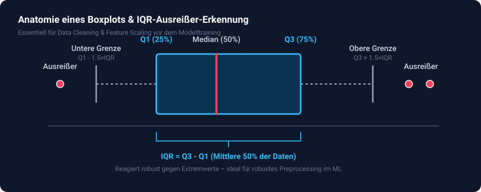
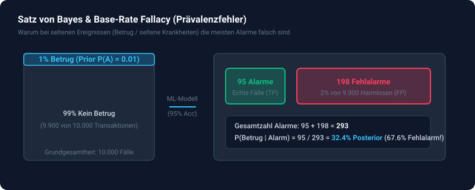
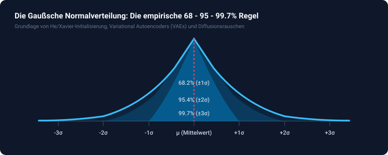
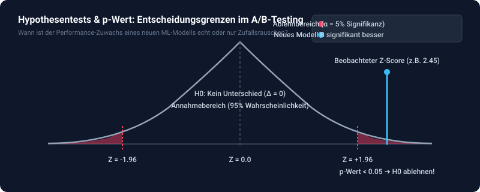
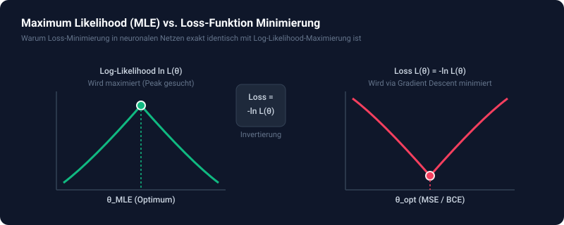
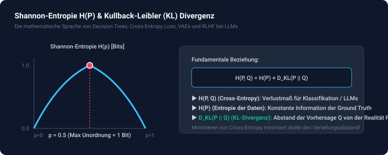
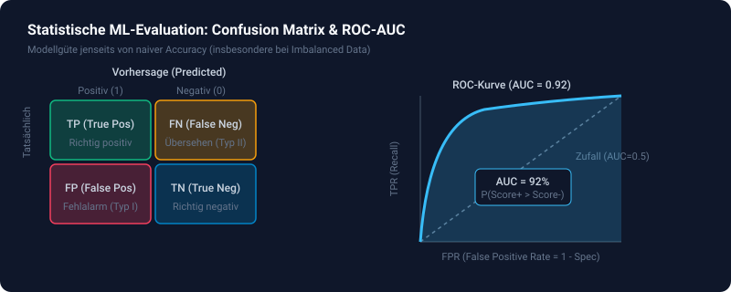
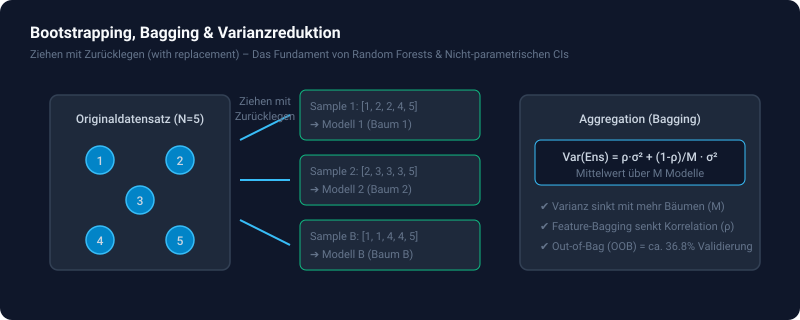
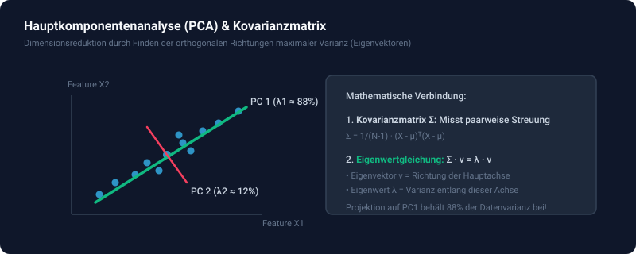
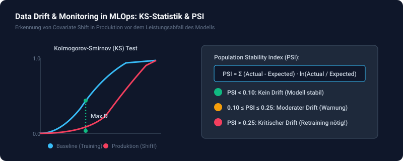

# 📖 Illustriertes Studien-Handbuch: Theorie, Visualisierungen & Video-Guides

Willkommen zu deinem visuellen Begleitbuch für den Kurs **Statistik für AI/ML-Engineers**.
Hier findest du zu jedem der 10 Module:
- 🖼️ **Visuelle Diagramme & Charts** zur intuitiven Veranschaulichung
- 📐 **Mathematische Formeln & Schritt-für-Schritt-Anleitungen**
- 🔢 **Ein durchgerechnetes Zahlenbeispiel von Hand**
- 💻 **Python-Tipps & Tricks** für die Implementierung
- 🎥 **Direkte Video-Links (YouTube / Vorlesungen)** und interaktive Web-Tools

---

## 📑 Inhaltsverzeichnis

- [Modul 01: Deskriptive Statistik, EDA & Outlier Detection](#modul-01-deskriptive-statistik-eda--outlier-detection)
- [Modul 02: Wahrscheinlichkeitsrechnung & Bayes-Theorem](#modul-02-wahrscheinlichkeitsrechnung--bayes-theorem)
- [Modul 03: Verteilungen & Zentraler Grenzwertsatz (CLT)](#modul-03-verteilungen--zentraler-grenzwertsatz-clt)
- [Modul 04: Hypothesentests & A/B-Testing für ML](#modul-04-hypothesentests--ab-testing-für-ml)
- [Modul 05: Maximum Likelihood Estimation (MLE) & Loss-Funktionen](#modul-05-maximum-likelihood-estimation-mle--loss-funktionen)
- [Modul 06: Informationstheorie (Entropie & KL-Divergenz)](#modul-06-informationstheorie-entropie--kl-divergenz)
- [Modul 07: Statistische ML-Evaluation & Metriken (ROC-AUC)](#modul-07-statistische-ml-evaluation--metriken-roc-auc)
- [Modul 08: Bootstrapping & Ensemble-Statistik (Bagging)](#modul-08-bootstrapping--ensemble-statistik-bagging)
- [Modul 09: Multivariate Statistik, Kovarianzmatrix & PCA](#modul-09-multivariate-statistik-kovarianzmatrix--pca)
- [Modul 10: Data Drift & Monitoring in MLOps (PSI & KS)](#modul-10-data-drift--monitoring-in-mlops-psi--ks)

---

## Modul 01: Deskriptive Statistik, EDA & Outlier Detection

### 🖼️ Visuelle Darstellung: Boxplot & IQR-Methode

### 1. Mathematische Formeln
- **Arithmetisches Mittel (Mean):** $\mu = \frac{1}{n} \sum_{i=1}^n x_i$
- **Median:** Bei sortierter Liste $s$:
  - Ungerades $n$: $s[\lfloor n / 2 \rfloor]$
  - Gerades $n$: $\frac{s[n/2 - 1] + s[n/2]}{2}$
- **Stichproben-Varianz (Bessel-Korrektur):** $s^2 = \frac{1}{n - 1} \sum_{i=1}^n (x_i - \mu)^2$  
  *(Warum $n-1$? Weil die Stichprobe die Varianz der Population systematisch unterschätzt!)*
- **Populations-Varianz:** $\sigma^2 = \frac{1}{n} \sum_{i=1}^n (x_i - \mu)^2$
- **Standardabweichung:** $s = \sqrt{s^2}$
- **Stichproben-Kovarianz:** $\text{Cov}(x, y) = \frac{1}{n - 1} \sum_{i=1}^n (x_i - \mu_x)(y_i - \mu_y)$
- **Pearson-Korrelationskoeffizient:** $r = \frac{\text{Cov}(x, y)}{s_x \cdot s_y} \in [-1, +1]$
- **Interquartilsabstand (IQR):** $\text{IQR} = Q_3 - Q_1$  
  $\text{Grenzen}: [\text{Unterer Grenzwert} = Q_1 - 1.5 \cdot \text{IQR}, \; \text{Oberer Grenzwert} = Q_3 + 1.5 \cdot \text{IQR}]$

### 2. Durchgerechnetes Zahlenbeispiel
Gegeben: Daten $x = [10.0, 12.0, 12.0, 13.0, 12.0, 14.0, 25.0]$ (Länge $n = 7$)
1. **Sortiert:** $[10.0, 12.0, 12.0, 12.0, 13.0, 14.0, 25.0]$
2. **Mean:** $\frac{10 + 12 + 12 + 12 + 13 + 14 + 25}{7} = \frac{98}{7} = 14.00$
3. **Median:** Mittleres Element (Index 3) = $12.00$  
   *(Beachte: Mean 14.00 ist deutlich höher als Median 12.00 wegen des Ausreißers 25.0!)*
4. **Varianz ($s^2$):** Summe der Quadrate $= (10-14)^2 + 3\cdot(12-14)^2 + (13-14)^2 + (14-14)^2 + (25-14)^2 = 16 + 12 + 1 + 0 + 121 = 150$.  
   $s^2 = \frac{150}{7 - 1} = \frac{150}{6} = 25.00$
5. **Standardabweichung:** $s = \sqrt{25.00} = 5.00$
6. **IQR & Ausreißer:**
   - Untere Hälfte $[10, 12, 12] \implies Q_1 = 12.0$
   - Obere Hälfte $[13, 14, 25] \implies Q_3 = 14.0$
   - $\text{IQR} = 14.0 - 12.0 = 2.0$
   - Obergrenze $= 14.0 + 1.5 \cdot 2.0 = 17.0 \implies 25.0 > 17.0 \implies \mathbf{25.0 \text{ ist ein Ausreißer!}}$

### 3. Python-Tipps
- Sortieren: `s = sorted(data)`
- Mittlerer Index: `mid = len(s) // 2`
- Summe der quadrierten Abweichungen: `sum((x - mean_val) ** 2 for x in data)`

### 4. 🎥 Videos & Lernmaterialien
- 🎬 [StatQuest: Variance and Standard Deviation, Clearly Explained](https://www.youtube.com/watch?v=SzZ6G434EBs)
- 🎬 [StatQuest: Covariance and Correlation](https://www.youtube.com/watch?v=qtaqvPAeEJY)
- 🎬 [Khan Academy: Box and Whisker Plots](https://www.youtube.com/watch?v=b2C9I8HuCe4)
- 📚 [Think Stats 2e (Allen Downey) - Kapitel 1 & 2](https://greenteapress.com/wp/think-stats-2e/)

---

## Modul 02: Wahrscheinlichkeitsrechnung & Bayes-Theorem

### 🖼️ Visuelle Darstellung: Bayes-Theorem & Base-Rate Fallacy

### 1. Mathematische Formeln
- **Satz von Bayes:**
  $$P(A \mid B) = \frac{P(B \mid A) \cdot P(A)}{P(B)}$$
- **Gesetz der totalen Wahrscheinlichkeit für Evidenz $P(B)$:**
  $$P(B) = P(B \mid A) \cdot P(A) + P(B \mid \neg A) \cdot P(\neg A)$$
- **Odds & Wahrscheinlichkeiten:**
  $$\text{Odds} = \frac{p}{1 - p} \iff p = \frac{\text{Odds}}{1 + \text{Odds}}$$
- **Naive Bayes Klassifikator:**
  $$P(\text{Spam} \mid w_1, \dots, w_k) \propto P(\text{Spam}) \cdot \prod_{j=1}^k P(w_j \mid \text{Spam})$$

### 2. Durchgerechnetes Zahlenbeispiel
- Betrugsrate (Prior): $P(\text{Betrug}) = 0.01$ (1%) $\implies P(\text{Kein Betrug}) = 0.99$
- Modell-Sensitivität: $P(\text{Alarm} \mid \text{Betrug}) = 0.95$ (95% Trefferquote)
- Falschalarm-Rate: $P(\text{Alarm} \mid \text{Kein Betrug}) = 0.02$ (2% False Positives)
1. Gesamtwahrscheinlichkeit eines Alarms:
   $$P(\text{Alarm}) = (0.95 \cdot 0.01) + (0.02 \cdot 0.99) = 0.0095 + 0.0198 = 0.0293$$
2. Tatsächliche Betrugswahrscheinlichkeit bei Alarm (Posterior):
   $$P(\text{Betrug} \mid \text{Alarm}) = \frac{0.0095}{0.0293} \approx 0.3242 \quad (\mathbf{32.4\%})$$
   *Erkenntnis:* Trotz 95% Modell-Genauigkeit sind fast 68% aller Alarme Falschalarme, weil Betrug so selten ist!

### 3. Python-Tipps
- Wörter abrufen mit Default-Wahrscheinlichkeit: `word_probs_spam.get(w.lower(), 0.01)`
- Wahrscheinlichkeit normalisieren: `p_spam = unnorm_spam / (unnorm_spam + unnorm_ham)`

### 4. 🎥 Videos & Lernmaterialien
- 🎬 [3Blue1Brown: Bayes theorem, and making probability intuitive](https://www.youtube.com/watch?v=HZGCoVF3YvM)
- 🎬 [StatQuest: Naive Bayes, Clearly Explained](https://www.youtube.com/watch?v=O2L2Uv9pdDA)
- 🎬 [Harvard Stat 110: Lecture 2 - Conditioning and Bayes' Rule](https://www.youtube.com/watch?v=JzDvvgpnxs8)
- 🌐 [Seeing Theory: Chapter 2 - Compound Probability](https://seeing-theory.brown.edu/compound-probability/index.html)

---

## Modul 03: Verteilungen & Zentraler Grenzwertsatz (CLT)

### 🖼️ Visuelle Darstellung: Die Gaußsche 68 - 95 - 99.7 Regel

### 1. Mathematische Formeln
- **Gaußsche Normalverteilung (PDF):**
  $$f(x) = \frac{1}{\sigma \sqrt{2\pi}} \exp\left( -\frac{1}{2} \left(\frac{x - \mu}{\sigma}\right)^2 \right)$$
- **Standardfehler des Mittelwerts (Standard Error of the Mean - SEM):**
  $$\text{SEM} = \frac{\sigma}{\sqrt{n}}$$
- **Zentraler Grenzwertsatz (CLT):** Für jede beliebige Ausgangsverteilung mit Mittelwert $\mu$ und Varianz $\sigma^2$ nähert sich die Verteilung des Stichprobenmittels $\bar{X}_n$ einer Normalverteilung an:
  $$\bar{X}_n \xrightarrow{d} \mathcal{N}\left(\mu, \frac{\sigma^2}{n}\right)$$
- **95%-Konfidenzintervall:** $[\bar{X} - 1.96 \cdot \text{SEM}, \; \bar{X} + 1.96 \cdot \text{SEM}]$

### 2. Durchgerechnetes Zahlenbeispiel
- Peak der Standardnormalverteilung ($\mu = 0, \sigma = 1$) an der Stelle $x = 0$:
  $$f(0) = \frac{1}{1 \cdot \sqrt{2 \cdot 3.14159}} \cdot \exp(0) = \frac{1}{2.5066} \cdot 1.0 \approx 0.39894$$
- Stichprobe mit Standardabweichung $s = 10.0$ und Umfang $n = 100$:
  $$\text{SEM} = \frac{10.0}{\sqrt{100}} = \frac{10.0}{10} = 1.00$$
  Liegt der Mittelwert bei $\bar{X} = 50.0$, lautet das 95%-Konfidenzintervall $[50 - 1.96, \; 50 + 1.96] = [48.04, \; 51.96]$.

### 3. Python-Tipps
- Normal PDF: `(1.0 / (sigma * math.sqrt(2 * math.pi))) * math.exp(-0.5 * ((x - mu) / sigma) ** 2)`
- Ziehen aus Exponentialverteilung: `random.expovariate(1.0)`

### 4. 🎥 Videos & Lernmaterialien
- 🎬 [StatQuest: The Normal Distribution, clearly explained](https://www.youtube.com/watch?v=rzFX5NWojp0)
- 🎬 [StatQuest: The Central Limit Theorem](https://www.youtube.com/watch?v=YAlJCEDH2uY)
- 🎬 [3Blue1Brown: But what is the Central Limit Theorem?](https://www.youtube.com/watch?v=zeJD6dqJ5lo)
- 🌐 [Seeing Theory: Chapter 3 - Probability Distributions](https://seeing-theory.brown.edu/probability-distributions/index.html)

---

## Modul 04: Hypothesentests & A/B-Testing für ML

### 🖼️ Visuelle Darstellung: Nullhypothese, Alpha & p-Wert

### 1. Mathematische Formeln
- **Zwei-Stichproben-Z-Test für Anteile (Click-Through-Rate):**
  $$p_A = \frac{k_A}{n_A}, \quad p_B = \frac{k_B}{n_B}$$
  $$p_{\text{pool}} = \frac{k_A + k_B}{n_A + n_B}, \quad \text{SE}_{\text{pool}} = \sqrt{p_{\text{pool}} (1 - p_{\text{pool}}) \left(\frac{1}{n_A} + \frac{1}{n_B}\right)}$$
  $$z = \frac{p_B - p_A}{\text{SE}_{\text{pool}}}$$
- **Zweiseitiger p-Wert:**
  $$p = \text{erfc}\left( \frac{|z|}{\sqrt{2}} \right)$$
- **Stichprobengrößen-Abschätzung (Evan-Miller-Formel):**
  $$n \approx \frac{16 \cdot p (1 - p)}{\Delta^2}$$

### 2. Durchgerechnetes Zahlenbeispiel
- Variante A: 1.000 Klicks bei 20.000 Nutzern ($p_A = 0.05$)
- Variante B: 1.150 Klicks bei 20.000 Nutzern ($p_B = 0.0575$)
- $p_{\text{pool}} = \frac{2150}{40000} = 0.05375$
- $\text{SE}_{\text{pool}} = \sqrt{0.05375 \cdot 0.94625 \cdot \left(\frac{1}{20000} + \frac{1}{20000}\right)} = \sqrt{0.05086 \cdot 0.0001} \approx 0.002255$
- $z = \frac{0.0575 - 0.0500}{0.002255} \approx \mathbf{3.325}$
- Da $z = 3.325 > 1.96$ (bzw. $p \approx 0.00088 < 0.05$), ist das Ergebnis **statistisch hochsignifikant** $\implies$ Modell B deployen!

### 3. Python-Tipps
- P-Wert via komplementäre Fehlerfunktion: `math.erfc(abs(z) / math.sqrt(2.0))`
- Ganzzahliges Aufrunden: `math.ceil(n)`

### 4. 🎥 Videos & Lernmaterialien
- 🎬 [StatQuest: Hypothesis Testing and p-values](https://www.youtube.com/watch?v=vemZtEM63GY)
- 🎬 [StatQuest: False Positives and False Discovery Rates](https://www.youtube.com/watch?v=K8LQSvtjcEo)
- 📝 [Evan Miller: How Not To Run an A/B Test](https://www.evanmiller.org/how-not-to-run-an-ab-test.html)

---

## Modul 05: Maximum Likelihood Estimation (MLE) & Loss-Funktionen

### 🖼️ Visuelle Darstellung: MLE-Peak vs. Loss-Minimierung

### 1. Mathematische Formeln
- **Likelihood & Log-Likelihood:**
  $$L(\theta) = \prod_{i=1}^n P(x_i \mid \theta) \implies \ln L(\theta) = \sum_{i=1}^n \ln P(x_i \mid \theta)$$
- **Analytischer Normalverteilungs-MLE:**
  $$\hat{\mu} = \frac{1}{n} \sum_{i=1}^n x_i, \quad \hat{\sigma}^2 = \frac{1}{n} \sum_{i=1}^n (x_i - \hat{\mu})^2 \quad \text{(Divisor } n \text{, nicht } n-1 \text{!)}$$
- **Herleitung von Mean Squared Error (MSE) aus Gaußschem NLL:**
  $$\text{NLL} = \frac{n}{2} \ln(2\pi\sigma^2) + \frac{1}{2\sigma^2} \sum_{i=1}^n (y_i - \hat{y}_i)^2 \propto \sum_{i=1}^n (y_i - \hat{y}_i)^2$$
- **Herleitung von Binary Cross-Entropy (BCE) aus Bernoulli:**
  $$\text{BCE} = -\frac{1}{n} \sum_{i=1}^n \left[ y_i \ln(p_i) + (1 - y_i) \ln(1 - p_i) \right]$$

### 2. Durchgerechnetes Zahlenbeispiel
- Daten $y_{\text{true}} = [1, 0]$, Modell-Wahrscheinlichkeiten $p = [0.90, 0.10]$:
  - Datenpunkt 1: $1 \cdot \ln(0.90) = -0.1054$
  - Datenpunkt 2: $1 \cdot \ln(1 - 0.10) = \ln(0.90) = -0.1054$
  - Log-Likelihood $= -0.1054 + (-0.1054) = -0.2107$
  - $\text{BCE Loss} = -\frac{1}{2} \cdot (-0.2107) = \mathbf{0.1054}$

### 3. Python-Tipps
- Clipping gegen $\ln(0)$ Unterlauf: `p_clip = max(eps, min(1.0 - eps, p))`

### 4. 🎥 Videos & Lernmaterialien
- 🎬 [StatQuest: Maximum Likelihood, clearly explained!!!](https://www.youtube.com/watch?v=XepXtl9YKwc)
- 🎬 [StatQuest: Maximum Likelihood for Logistic Regression](https://www.youtube.com/watch?v=BfKanl1aSG0)
- 🎬 [Stanford CS229: Machine Learning Lecture 2 - Linear Regression and Gradient Descent](https://www.youtube.com/watch?v=4b4MUYve_U8)

---

## Modul 06: Informationstheorie (Entropie & KL-Divergenz)

### 🖼️ Visuelle Darstellung: Shannon-Entropie & KL-Divergenz

### 1. Mathematische Formeln
- **Shannon-Entropie:**
  $$H(P) = - \sum_{i} P(x_i) \log_2 P(x_i) \quad [\text{Bits}]$$
- **Cross-Entropy:**
  $$H(P, Q) = - \sum_{i} P(x_i) \log_2 Q(x_i)$$
- **Kullback-Leibler (KL) Divergenz:**
  $$D_{\text{KL}}(P \parallel Q) = \sum_{i} P(x_i) \log_2 \left(\frac{P(x_i)}{Q(x_i)}\right)$$
- **Identität:** $H(P, Q) = H(P) + D_{\text{KL}}(P \parallel Q)$
- **Analytische KL-Divergenz zweier Normalverteilungen (VAE Latent Loss):**
  $$D_{\text{KL}}(\mathcal{N}_p \parallel \mathcal{N}_q) = \ln\left(\frac{\sigma_q}{\sigma_p}\right) + \frac{\sigma_p^2 + (\mu_p - \mu_q)^2}{2\sigma_q^2} - \frac{1}{2}$$

### 2. Durchgerechnetes Zahlenbeispiel
- Wahre Verteilung $P = [0.70, 0.30]$, Modellvorhersage $Q = [0.50, 0.50]$ (Basis 2):
  - $H(P) = - [0.7 \log_2(0.7) + 0.3 \log_2(0.3)] \approx - [0.7(-0.5146) + 0.3(-1.7370)] = 0.3602 + 0.5211 = \mathbf{0.8813 \text{ Bits}}$
  - $H(P, Q) = - [0.7 \log_2(0.5) + 0.3 \log_2(0.5)] = - [1.0 \cdot (-1.0)] = \mathbf{1.0000 \text{ Bits}}$
  - $D_{\text{KL}}(P \parallel Q) = 1.0000 - 0.8813 = \mathbf{0.1187 \text{ Bits}}$

### 3. Python-Tipps
- Logarithmus-Hilfsfunktion für Basis 2, e oder 10:
  `math.log2(x)` oder `math.log(x) / math.log(base)`

### 4. 🎥 Videos & Lernmaterialien
- 🎬 [3Blue1Brown: How to measure information: Shannon Entropy](https://www.youtube.com/watch?v=v68zYyaEm-U)
- 🎬 [StatQuest: Cross Entropy / Log Loss](https://www.youtube.com/watch?v=6ArSys5qHAU)
- 🎬 [StatQuest: KL Divergence, Clearly Explained!](https://www.youtube.com/watch?v=SxGYP83AZgk)

---

## Modul 07: Statistische ML-Evaluation & Metriken (ROC-AUC)

### 🖼️ Visuelle Darstellung: Confusion Matrix & ROC-AUC

### 1. Mathematische Formeln
- **Precision (Präzision):** $\frac{\text{TP}}{\text{TP} + \text{FP}}$
- **Recall (Sensitivität / TPR):** $\frac{\text{TP}}{\text{TP} + \text{FN}}$
- **F1-Score:** $2 \cdot \frac{\text{Precision} \cdot \text{Recall}}{\text{Precision} + \text{Recall}}$
- **ROC-AUC (Mann-Whitney-U-Statistik):**
  $$\text{AUC} = \frac{\sum_{p \in P} \sum_{n \in N} \left( \mathbb{I}(p > n) + 0.5 \cdot \mathbb{I}(p = n) \right)}{|P| \cdot |N|}$$
- **Brier-Score (Wahrscheinlichkeitskalibrierung):**
  $$\text{Brier} = \frac{1}{n} \sum_{i=1}^n (p_i - y_i)^2$$

### 2. Durchgerechnetes Zahlenbeispiel für ROC-AUC
- Labels $y = [1, 0, 1, 0]$, Modellscores $s = [0.9, 0.4, 0.7, 0.2]$
  - Positive Scores $P = [0.9, 0.7]$ (Länge 2)
  - Negative Scores $N = [0.4, 0.2]$ (Länge 2)
  - Vergleiche alle $2 \times 2 = 4$ Paare:
    - Paar (0.9, 0.4): $0.9 > 0.4 \implies +1.0$
    - Paar (0.9, 0.2): $0.9 > 0.2 \implies +1.0$
    - Paar (0.7, 0.4): $0.7 > 0.4 \implies +1.0$
    - Paar (0.7, 0.2): $0.7 > 0.2 \implies +1.0$
  - Summe Ranks $= 4.0 \implies \text{AUC} = \frac{4.0}{2 \cdot 2} = \mathbf{1.00}$ (Perfekte Rangordnung!)

### 3. Python-Tipps
- Positive/Negative trennen:
  `pos = [score for y, score in zip(y_true, y_scores) if y == 1]`
  `neg = [score for y, score in zip(y_true, y_scores) if y == 0]`

### 4. 🎥 Videos & Lernmaterialien
- 🎬 [StatQuest: ROC and AUC, Clearly Explained!](https://www.youtube.com/watch?v=4jRBRDbJemM)
- 🎬 [StatQuest: Precision and Recall, Clearly Explained](https://www.youtube.com/watch?v=Kfu3aJ5T57o)
- 🎬 [StatQuest: Sensitivity and Specificity](https://www.youtube.com/watch?v=vP06aMo6jCA)

---

## Modul 08: Bootstrapping & Ensemble-Statistik (Bagging)

### 🖼️ Visuelle Darstellung: Bootstrapping & Ensemble-Varianzreduktion

### 1. Mathematische Formeln
- **Bootstrap-Stichprobe:** $N$ Ziehungen aus Daten der Länge $N$ mit Zurücklegen (`with replacement`).
- **Nicht-parametrisches Konfidenzintervall (Perzentil-Methode):**
  Sortiere die berechneten Statistiken der $B$ Bootstrap-Samples. Für $95\%$ Konfidenz wähle Indizes bei $2.5\%$ und $97.5\%$.
- **Ensemble-Varianz eines Bagging-Modells:**
  $$\text{Var}(\text{Ensemble}) = \rho \cdot \sigma^2 + \frac{1 - \rho}{M} \cdot \sigma^2$$
  *(wobei $\sigma^2$ die Varianz eines Einzelbaums, $\rho$ die paarweise Korrelation und $M$ die Baum-Anzahl ist)*.

### 2. Durchgerechnetes Zahlenbeispiel
- Basis-Varianz $\sigma^2 = 10.0$, Baum-Korrelation $\rho = 0.20$:
  - Einzelner Baum ($M = 1$): $\text{Var} = 0.2 \cdot 10 + \frac{0.8}{1} \cdot 10 = 2 + 8 = \mathbf{10.0}$
  - Ensemble mit $M = 50$ Bäumen: $\text{Var} = 0.2 \cdot 10 + \frac{0.8}{50} \cdot 10 = 2 + 0.16 = \mathbf{2.16}$
  *(Die Varianz sinkt um fast 80%!)*

### 3. Python-Tipps
- Zufallsziehung mit Zurücklegen: `[random.choice(data) for _ in range(len(data))]`

### 4. 🎥 Videos & Lernmaterialien
- 🎬 [StatQuest: Bootstrapping Main Ideas!!!](https://www.youtube.com/watch?v=Xz0x-8-cgaQ)
- 🎬 [StatQuest: Random Forests Part 1 - Building, Using and Evaluating](https://www.youtube.com/watch?v=J4Wdy0Wc_xQ)
- 📚 [ISLR (James et al.) - Chapter 5.2: The Bootstrap](https://www.statlearning.com/)

---

## Modul 09: Multivariate Statistik, Kovarianzmatrix & PCA

### 🖼️ Visuelle Darstellung: Kovarianzmatrix & PCA-Hauptkomponenten

### 1. Mathematische Formeln
- **Mittelwertvektor $\mu \in \mathbb{R}^D$:** $\mu_j = \frac{1}{N} \sum_{i=1}^N X_{ij}$
- **Stichproben-Kovarianzmatrix $\Sigma \in \mathbb{R}^{D \times D}$:**
  $$\Sigma_{jk} = \frac{1}{N - 1} \sum_{i=1}^N (X_{ij} - \mu_j)(X_{ik} - \mu_k)$$
- **Erklärte Varianz (Explained Variance Ratio):**
  $$\text{Ratio}_j = \frac{\lambda_j}{\sum_{k=1}^D \lambda_k}$$
- **Projektion auf Hauptkomponente $v$:**
  $$z_i = \sum_{j=1}^D X_{\text{centered}, ij} \cdot v_j$$

### 2. Durchgerechnetes Zahlenbeispiel
- Eigenwerte einer $2\times 2$ Matrix: $\lambda_1 = 650.0, \; \lambda_2 = 10.0$
  - Gesamte Varianz: $650.0 + 10.0 = 660.0$
  - Anteil PC 1: $\frac{650.0}{660.0} \approx \mathbf{98.48\%}$
  - Anteil PC 2: $\frac{10.0}{660.0} \approx \mathbf{1.52\%}$

### 3. Python-Tipps
- Matrix zentrieren: `row_centered = [x - mu for x, mu in zip(row, means)]`
- Vektor-Skalarprodukt: `sum(a * b for a, b in zip(vec1, vec2))`

### 4. 🎥 Videos & Lernmaterialien
- 🎬 [3Blue1Brown: Essence of Linear Algebra - Eigenvectors and eigenvalues](https://www.youtube.com/watch?v=PFDu9oVAE-g)
- 🎬 [StatQuest: Principal Component Analysis (PCA), Step-by-Step](https://www.youtube.com/watch?v=FgakZw6K1QQ)
- 🌐 [Setosa.io: Visual Explanation of Principal Component Analysis](https://setosa.io/ev/principal-component-analysis/)
- 📚 [Mathematics for Machine Learning - Chapter 10: PCA](https://mml-book.com/)

---

## Modul 10: Data Drift & Monitoring in MLOps (PSI & KS)

### 🖼️ Visuelle Darstellung: ECDF-Abstand (KS-Test) & PSI-Ampel

### 1. Mathematische Formeln
- **Empirische Verteilungsfunktion (ECDF):**
  $$F(x) = \frac{1}{n} \sum_{i=1}^n \mathbb{I}(x_i \le x)$$
- **Kolmogorov-Smirnov (KS) Statistik:**
  $$D = \max_{x} |F_{\text{baseline}}(x) - F_{\text{production}}(x)| \in [0.0, 1.0]$$
- **Population Stability Index (PSI):**
  $$\text{PSI} = \sum_{b=1}^B (\text{Actual}_b - \text{Expected}_b) \cdot \ln\left( \frac{\text{Actual}_b}{\text{Expected}_b} \right)$$
  - $\text{PSI} < 0.10 \implies$ **Kein Drift** (Modell stabil)
  - $0.10 \le \text{PSI} \le 0.25 \implies$ **Moderater Drift** (Warnung / Beobachten)
  - $\text{PSI} > 0.25 \implies$ **Kritischer Drift** (Alarm / Retraining zwingend nötig)

### 2. Durchgerechnetes Zahlenbeispiel für PSI
- Bin 1: Expected $= 0.40$, Actual $= 0.10$  
  Term 1: $(0.10 - 0.40) \cdot \ln(0.10 / 0.40) = -0.30 \cdot (-1.3863) = \mathbf{+0.4159}$
- Bin 2: Expected $= 0.40$, Actual $= 0.30$  
  Term 2: $(0.30 - 0.40) \cdot \ln(0.30 / 0.40) = -0.10 \cdot (-0.2877) = \mathbf{+0.0288}$
- Bin 3: Expected $= 0.20$, Actual $= 0.60$  
  Term 3: $(0.60 - 0.20) \cdot \ln(0.60 / 0.20) = +0.40 \cdot (+1.0986) = \mathbf{+0.4394}$
- $\text{PSI} = 0.4159 + 0.0288 + 0.4394 = \mathbf{0.8841}$  
  $\implies \mathbf{0.8841 \gg 0.25 \implies \text{SIGNIFICANT\_DRIFT!}}$

### 3. Python-Tipps
- ECDF-Wert: `sum(1 for v in data if v <= x) / len(data)`
- Null-Schutz für Logarithmus: `max(1e-6, p)`

### 4. 🎥 Videos & Lernmaterialien
- 🎬 [StatQuest: The Kolmogorov-Smirnov Test](https://www.youtube.com/watch?v=0kSZeWw_3zQ)
- 🎬 [Evidently AI: How to detect Data Drift in Machine Learning](https://www.youtube.com/watch?v=GjYfS_kH4rY)
- 📝 [Evidently AI: What is PSI (Population Stability Index)?](https://www.evidentlyai.com/blog/population-stability-index-psi)
